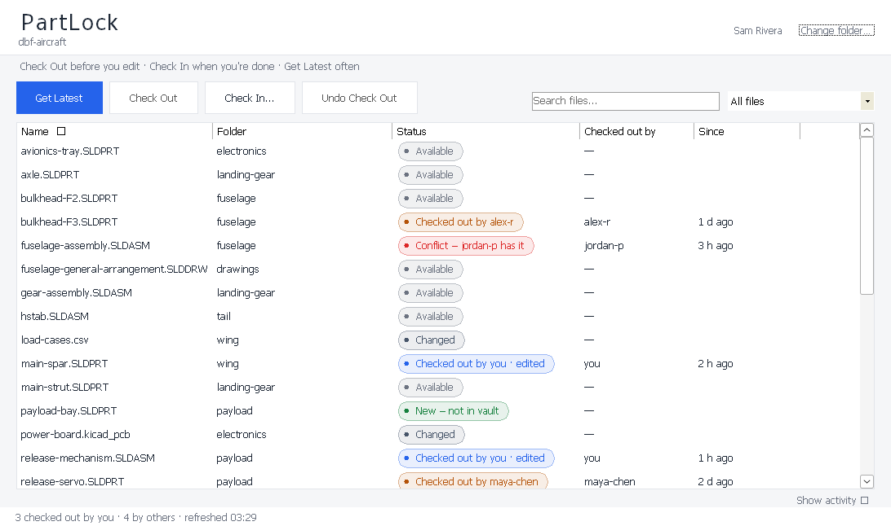

# PartLock - PDM

PartLock is a tiny check-out / check-in tool for a small CAD team: one button to get everyone's latest SolidWorks files, one to lock a part while you edit it, one to publish it back. It wraps Git and Git LFS file locking so nobody on the team has to learn git. Everything lives in a normal private GitHub repository, which gives you full history and free hosting for a student-sized project. It is built for about 15 people sharing one `main` branch — not a full PDM system.



- **Team members — start here:** [docs/TEAM-GUIDE.md](docs/TEAM-GUIDE.md)
- **Team lead — one-time setup, costs, releases:** [docs/ADMIN-SETUP.md](docs/ADMIN-SETUP.md)

## Build

Needs Docker (the .NET 8 SDK runs in a container, no local .NET install required):

```bash
./build.sh
```

Output: `out/PartLock.exe` — a .NET Framework 4.8 app that runs on stock Windows 10/11 with no runtime install.

## Test

The end-to-end suite starts a disposable Gitea server (with Git LFS and locking) in Docker and exercises the real `VaultService` against it:

```bash
./tests/run-e2e.sh
```

Needs Docker and network access to pull `gitea/gitea:1.22.6`, `curlimages/curl:8.10.1`, and `mcr.microsoft.com/dotnet/sdk:8.0`. The script cleans up its container and network, and exits non-zero on any failed scenario.
